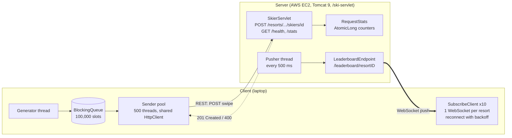
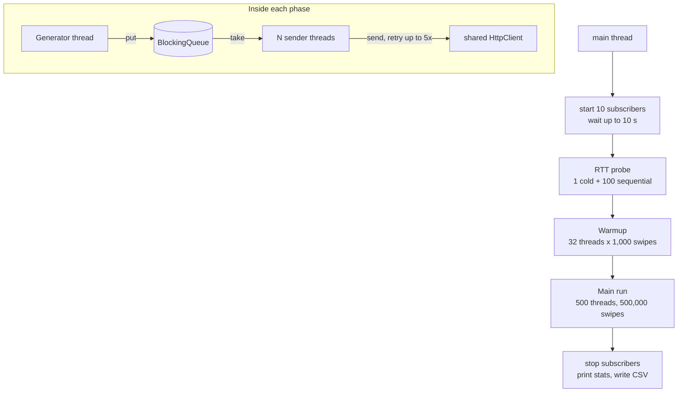

# CS6650 Assignment 1: Design Document

## 1. Architecture

- **REST path (ingest):** short request/response. The client sends swipes (a lift ride per request) and the server validates the URL and JSON body, then returns `201`, or `400` for invalid input.
- **WebSocket path (subscribe):** one long-lived connection per resort. The server pushes a synthetic leaderboard to every subscriber every 500 ms, so clients never poll.

## 2. Major classes

| Class | Role |
|---|---|
| `SkierServlet` | Handles `/resorts/*`, `/health`, `/stats` (mapped in `web.xml`). Validates the path (`resort/seasons/day/skiers`, numeric IDs) and body (`time` 1-360, `liftID` 1-40). Uses `LiftRide`, `ResponseMsg`, `RequestStats`. |
| `LeaderboardEndpoint` | `@ServerEndpoint("/leaderboard/{resortID}")`. Keeps `resortID -> Set<Session>`; one scheduled thread pushes JSON with a `serverTimestamp` to every open session. |
| `EchoEndpoint` | WebSocket echo used for early connection testing. |
| `RequestStats` | Thread-safe GET/POST counters (`AtomicLong`). |
| `SwipeClient` | Orchestrator: starts subscribers, measures round-trip time, runs warmup then main phase, prints metrics, writes `swipe_metrics.csv`. |
| `SwipeMessage` | Immutable random swipe (URL, JSON body, `resortID`). |
| `SubscribeClient` | WebSocket client endpoint plus connection management and subscribe-side metrics. |

## 3. Threading model (client)

- **Generator (1 dedicated thread):** creates `SwipeMessage`s and `put`s them on a bounded `LinkedBlockingQueue` (100,000 slots). It blocks when the queue is full, so memory stays bounded.
- **Sender pool (fixed thread pool):** each worker `take`s a message and sends it with a **single shared `HttpClient`** (HTTP/1.1, keep-alive, so one connection per busy thread). Workers claim message slots from a shared `AtomicInteger`, so any message/thread counts work.
- **Failure handling:** up to 5 retries with backoff (50 ms x 2^attempt) on connection errors or 5xx; 4xx are not retried; 10 s request timeout.
- **Phases:** (1) *RTT probe*: one cold request plus 100 sequential requests; (2) *warmup*: 32 threads x 1,000 = 32,000 swipes, timed and reported separately and excluded from CSV and statistics; (3) *main run*: 500 threads, 500,000 swipes. Each phase has its own queue, generator, and pool. The `HttpClient` is shared, so main-run connections start warm.
- **Metrics:** counters are atomic; each swipe records `{start time, latency, status, resortID}` in a `ConcurrentLinkedQueue`, written to CSV after the run.

## 4. WebSocket connection management (client)

- **Subscription pool:** 10 subscribers, one per resort (1-10), connected through a 10-thread `ScheduledExecutorService` **before** the ingest starts (the client waits up to 10 s for all to connect). They stay open for the whole run, and the message callbacks run on the WebSocket library's own threads.
- **Reconnect:** `@OnClose` schedules a reconnect after 1 s. A failed connect retries with exponential backoff (1, 2, 4, ... capped at 30 s). Reconnects run on the scheduler, never on the library's I/O thread. A `shuttingDown` flag stops reconnects during the deliberate close at the end.
- **Metrics:** connections and reconnects, handshake time per resort, updates per subscriber, push latency (receive time minus `serverTimestamp`).

## 5. Little's Law

Throughput = L / W, where L = concurrent requests in flight and W = time per request.

- **L = 500** (one in-flight request per sender thread).
- **W = 21.0 ms**: average of 100 sequential requests after the first. The first request took 75.4 ms (TCP connection setup), but that cost is paid once per connection and spread over about 1,000 requests, so it is negligible.
- **Predicted maximum = 500 / 0.0210 s = 23,864 swipes/s.**
- **Measured = 9,162 swipes/s (38% of predicted).**

## 6. Results and analysis

| Metric | Value |
|---|---|
| Successful / failed swipes | 500,000 / 0 (138 retries after connection errors, all recovered) |
| Main run wall-clock | 54.6 s (warmup: 31.8 s for 32,000 swipes) |
| Throughput | 9,162 swipes/s (about 915/s per resort, evenly spread) |
| Latency, ms | mean 54.1, median 45.2, p95 106.6, p99 223.1, min 14.6, max 2,362 |
| Subscribers | 10 connections, 0 reconnects, handshake 210-215 ms, 178 updates each (1,780 total, about 19.9/s) |

- **Throughput over time** (`results/throughput_10s.png`): about 7,900/s in the first 10 s (connection ramp-up), then flat at about 9,400-9,500/s.
- **Why the prediction was missed:** Little's Law only predicts the maximum when W stays constant. Under load W grew from 21 ms to 54 ms, which is queueing. Using the loaded W gives 500 / 0.0541 = 9,242 swipes/s, which matches the measured rate. Scaling was also sublinear: 32 warmup threads gave about 1,000 swipes/s, and 500 threads gave 9,162.
- **Likely bottleneck:** the server's CPU. Tomcat used about 180% CPU (1.8 cores) during the run on an instance with **[N] vCPUs, [instance type]**, while memory use stayed near 30%. That is about 0.2 ms of CPU per request, which is high for this servlet. The two `logger.info` calls per POST are a suspected contributor; this has not been measured yet.
- **The queue is not the bottleneck:** average in-flight requests = 9,162 x 0.0541 s = 496, which matches the 500 threads. The sender threads spend essentially all their time waiting on HTTP responses, not on the queue.
- **Push latency caveat:** the measured values are negative (mean -82 ms). The server's `serverTimestamp` and the client's receive time come from different machines, and the EC2 clock runs about 80 ms ahead of the laptop's. The values show clock skew, not real delivery delay. NTP-synced clocks would be needed for an absolute number, but delivery was steady: 178 updates per subscriber matches the expected 2 per second over the roughly 89 s the subscribers were connected, with no reconnects.
