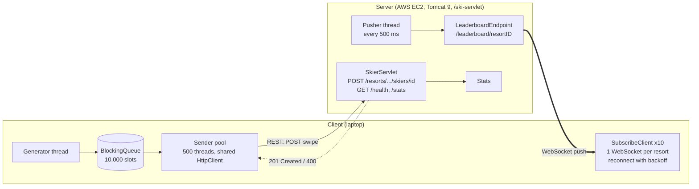
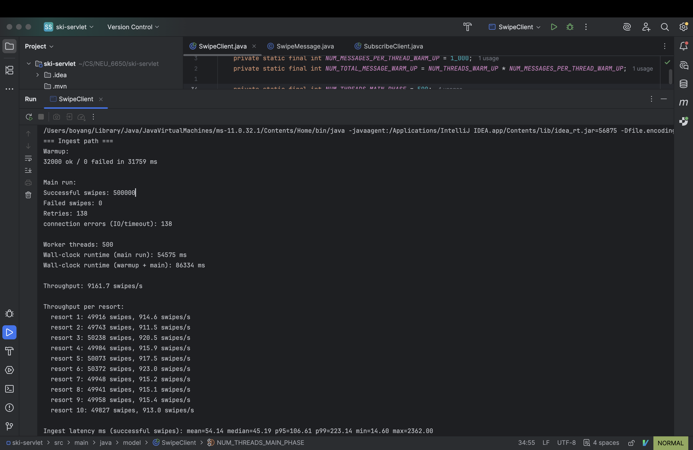
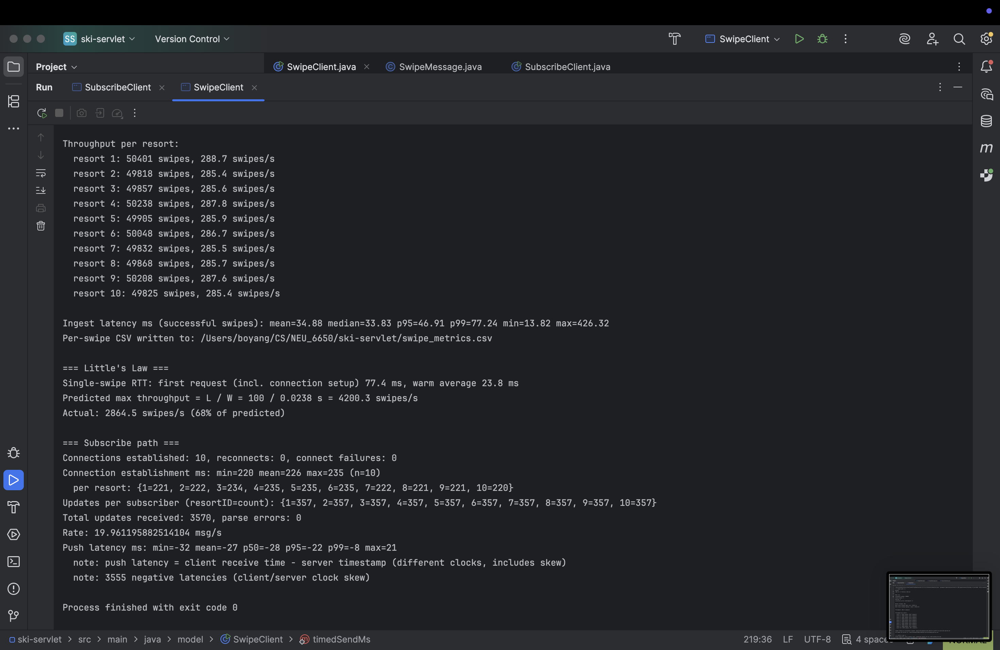
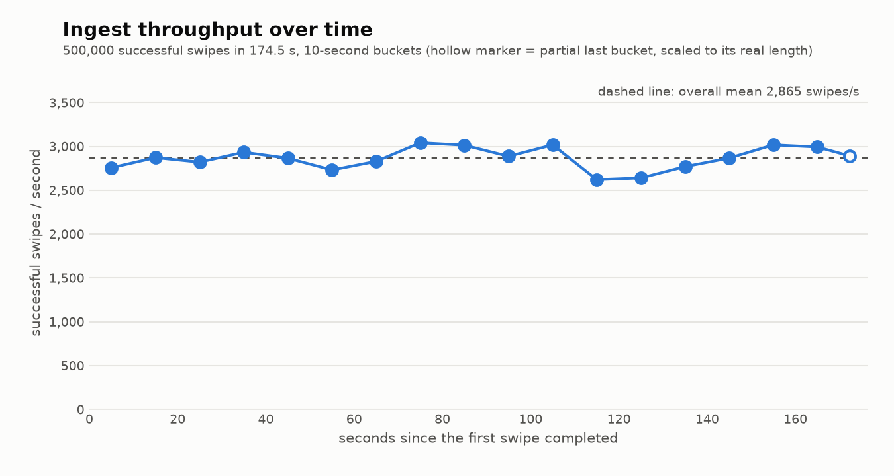
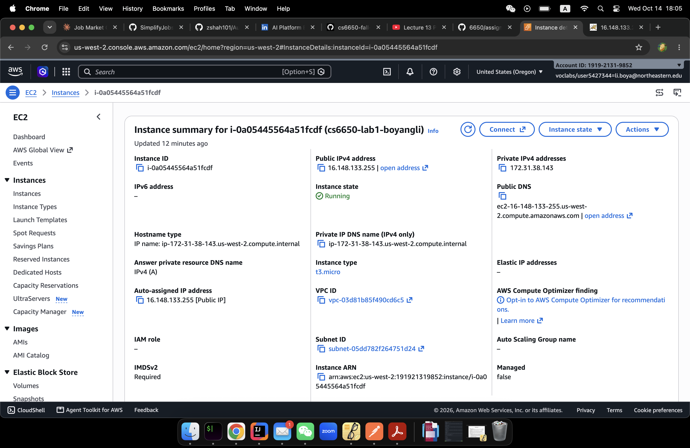
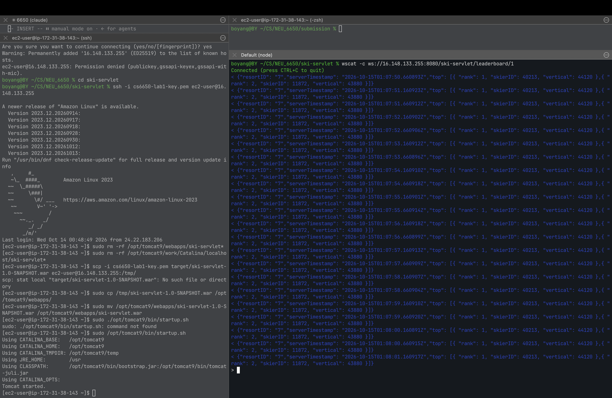

## CS6650 Assignment 1: Design Document

**Name: Boyang Li**
**Project repository:** https://github.com/boyanglineu-prog/6650 

### 1. Architecture

### 2. Major classes

**Server**

- `SkierServlet` handles `/resorts/*`, `/health`, and `/stats` (mapped in `web.xml`).
- `LeaderboardEndpoint` is the WebSocket endpoint. It keeps a map of sessions, and one scheduled thread pushes the leaderboard to every subscriber every 500 ms.
- `RequestStats` holds thread-safe GET and POST counters (`AtomicLong`).

**Client**

- `SwipeClient` is the orchestrator. It starts the subscribers, measures the round-trip time, runs the warmup and then the main phase, prints the metrics, and writes `swipe_metrics.csv`. It uses `SwipeMessage` to create the requests and `SubscribeClient` for the WebSocket side.
- `SubscribeClient` is the WebSocket client. It keeps one connection per resort.

### 3. Threading model (client)

**Run order (main thread):**

**Inside each phase (warmup and main run):**

- **Generator (1 dedicated thread):** creates `SwipeMessage`s and `put`s them on a bounded `LinkedBlockingQueue` (10,000 slots). 
- **Sender pool (fixed thread pool):** each worker `take`s a message and sends it with a **single shared `HttpClient`** 
- **Failure handling:** up to 5 retries with backoff (50 ms x 2^attempt) on connection errors or 5xx; 4xx are not retried; 10 s request timeout.
- **Phases:** (1) *RTT probe*: one cold request plus 100 sequential requests; (2) *warmup*: 32 threads x 1,000 = 32,000 swipes; (3) *main run*: 500 threads, 500,000 swipes.
- **Metrics:** counters are atomic; each swipe records `{start time, latency, status, resortID}` in a `ConcurrentLinkedQueue`, written to CSV after the run.

### 4. WebSocket connection management (client)

- **Subscription pool:** 10 subscribers, one per resort (1-10), connected through a 10-thread `ScheduledExecutorService`.
- **Reconnect:** `@OnClose` schedules a reconnect after 1 s. A failed connect retries with exponential backoff (1, 2, 4, ... capped at 30 s).
- **Metrics:** connections and reconnects, handshake time per resort, updates per subscriber, push latency (receive time minus `serverTimestamp`).

### 5. Little's Law

Throughput = L / W, where L = concurrent requests in flight and W = time per request.

- **L = 500** (one in-flight request per sender thread).
- **W = 21.0 ms**: average of 100 sequential requests.
- **Predicted maximum**: 500 / 0.0210 s = 23,864 swipes/s.
- **Measured**: 9,162 swipes/s (38% of predicted).

## CS6650 Assignment 1: Result & Analysis

### 1. Part 1 output: basic metrics, warmup reported separately

### 2. Part 2 output: ingest and push-latency statistics

| Metric | Value |
|---|---|
| Successful / failed swipes | 500,000 / 0 |
| Throughput | 9,162 swipes/s (about 915/s per resort, evenly spread) |
| Ingest latency, ms | mean 54.1, median 45.2, p95 106.6, p99 223.1, min 14.6, max 2,362 |
| Little's Law | predicted 23,864 swipes/s, measured 9,162 (38%) |
| Subscribers | 10 connections, 0 reconnects, handshake 210-215 ms, 178 updates each (1,780 total, about 19.9/s) |

### 3. Throughput over time

### 4. EC2 deployment

### 5. WebSocket subscriber receiving leaderboard pushes

### 6. Analysis

- **Why the prediction was missed:** Little's Law only predicts the maximum when W stays constant. Under load W grew from 21 ms to 54 ms, which is queueing. Using the loaded W gives 500 / 0.0541 = 9,242 swipes/s, which matches the measured rate. 
- **The queue is not the bottleneck:** average in-flight requests = 9,162 x 0.0541 s = 496, which matches the 500 threads. The sender threads spend essentially all their time waiting on HTTP responses, not on the queue.
- **Server CPU is the bottleneck:** `top` on the EC2 instance (`t3.micro`, 2 vCPUs) showed about 180% CPU at peak, roughly 90% of its capacity.
- **Push latency is negative** (mean -82 ms) because `serverTimestamp` comes from the EC2 clock and the receive time from the laptop clock, therre is time-drift.
